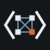
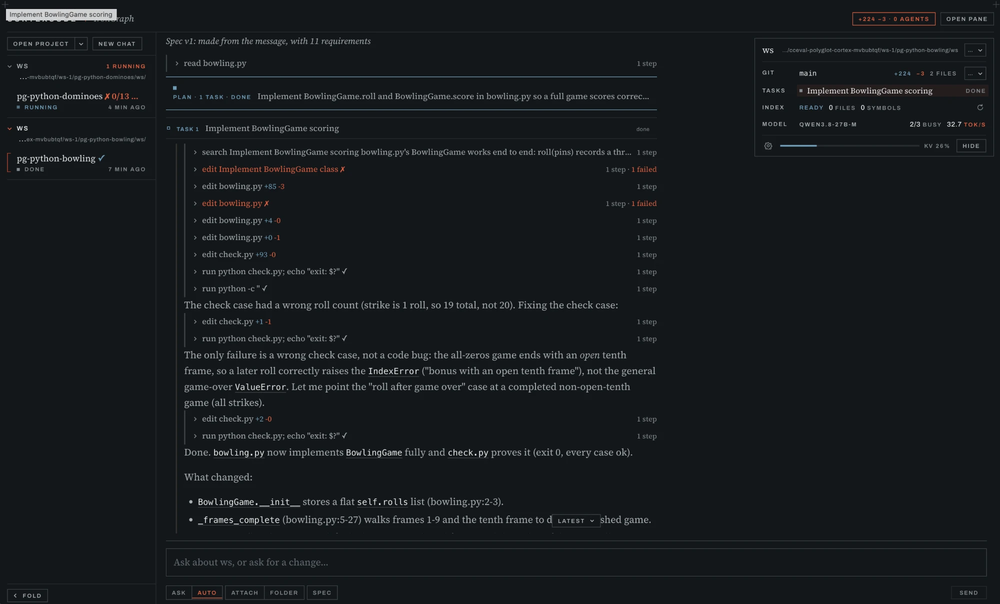

<p align="center">
  
</p>

<h1 align="center">CortexCode</h1>

<p align="center">
  <strong>An opinionated, fully modular, local-LLM coding IDE and agent harness.</strong><br/>
  One preselected model, tuned end to end and pushed to its limits, on your own machine, offline.
</p>

<p align="center">
  <a href="https://ironcortexcode.tech">ironcortexcode.tech</a> ·
  <a href="LICENSE.txt">Apache-2.0</a>
</p>

---

<p align="center">
  
</p>

## Why CortexCode

Most coding agents are built for frontier cloud models and then "also support" local ones. A small
local model gets the same giant prompts, the same tool zoo, the same expectations, and it falls
apart. CortexCode goes the other way. It starts from one capable local model and builds the whole
harness around how that model actually behaves.

- **Local first, private by default.** Your code, prompts and history stay on your machine. No API
  keys, no usage bills, no telemetry. The model runs offline.
- **Opinionated on purpose.** Instead of a dropdown of hundreds of models, CortexCode ships with one
  preselected model and engine, and every prompt, stage, tool and limit is measured against it. Fewer
  choices, much better results.
- **Fully modular.** Everything is a plugin: the chat flow, the model, memory and the code graph,
  the tools, language support, skills, agents, even the theme. Replace any piece with your own
  without forking the rest.
- **A real IDE, not a chat box.** Code view with inline diffs, a terminal, a browser, git, a project
  board and agents all live in one desktop app.

## Built for the small model

> A small model doesn't follow rules. It follows the nearest strong cue at the moment it decides.

This one idea shapes the whole product:

- **The right context, right before each decision.** The task, the files it touches and the full
  evidence (like test output) sit right where the model makes its next move. Summaries and noise
  stay out.
- **Meaning, not data dumps.** The model never gets a repository map or a pile of files. It gets a
  description of the project and its own rules, then finds code inside each task through semantic
  search and targeted reads.
- **Plan first, then discover.** A change is planned from the request, then each step finds exactly
  the code it needs.
- **The host decides what it can.** Anything the system can settle from hard facts, it settles
  itself. The model's steps stay small, focused and quick.
- **Tools that don't waste steps.** Every tool result carries only the answer, and every failure
  ends with the next step to take. Malformed tool calls get repaired instead of rejected.
- **Grammar-constrained decisions.** Routing, plans and tool calls are decoded against a schema, so
  the model can't drift out of format.

## The model, pushed to its limits

CortexCode ships with **Qwen3.8-27B (4-bit)** running in process on Apple silicon's Metal GPU, chosen
after a bake-off of more than a dozen local inference engines.

- **Lossless speculative decoding** for much faster generation with identical output.
- **Per-conversation KV cache** that is kept and reused, so follow-ups start right away.
- **Hibernate and prewarm** to keep memory free when idle and waits short when you return.
- **Live progress at all times:** tokens, speed and the streaming decision are always visible.
- **A local OpenAI-compatible endpoint**, so other tools on your machine can use the same model.

## Highlights

**A code graph that understands your project.** An embedded graph database indexes symbols, call
sites, cross-language links (a frontend fetch to the backend route it hits) and your docs. It powers
semantic search, impact analysis and "who calls this" answers in milliseconds.

**Agents that never touch your work.** Delegate a goal and it becomes a task tree with clear
contracts. Named agents work in copy-on-write workspaces, every result is verified against the
project's own checks, and a merge steward brings the work back. Your uncommitted changes are never
committed by an agent.

**Safe hands.** Shell commands run in a write sandbox with a per-project Python environment.
Ask-mode approvals stay in your control, and shadow checkpoints let you roll back without ever
rewriting your git history.

**Real language intelligence.** Rust, Python, TypeScript and JavaScript, Go, Java, C and C++, shell,
HTML and CSS, Docker. Each language plugin brings its language server diagnostics, go-to-definition,
references, the right build and test verifiers, and skills written for the model. Toolchains install
themselves.

**Containers when you want them.** Run a project's commands inside Docker, a Compose service or a
devcontainer while its files stay on your machine.

**Skills that actually help.** Compact, practical know-how for engineering, data, design and the
terminal. Each skill is short, concrete and chosen only when it helps the task at hand.

**Research when you are online.** Optional deep research across papers, code, forums and the web,
with cited notes that land in your project's knowledge. Fully off when you are offline.

**An app that learns.** CortexCode's skills, prompts and texts are live files it and you can edit
while it runs; every edit is kept in a history you can revert, back up and share.

**Plugins as packages.** Install, enable, disable, replace and roll back plugins from Settings. Each
plugin talks to the rest only through a typed contract, so any part can be swapped for another that
speaks the same contract.

## Who it is for

- Developers who want a capable coding agent that is **private, offline and free to run**.
- Teams that can't send source code to a cloud model.
- Tinkerers who want to **swap, extend or rewrite any part** of their coding assistant.
- Anyone curious how far a well-designed harness can push a local model.

## Requirements

- A Mac with Apple silicon and **32 GB** of unified memory or more (Linux x64 and arm64 builds are
  prepared; the Linux model engine is not there yet).
- Disk space for the model (downloaded on first start).

## Install

```sh
npx cortexcode
```

The first run downloads the app for your machine from this repository's releases, checks it
against the checksum in the release catalog and starts it; later runs start the installed app at
once, and the app updates itself. On Linux you
can also unpack the `.tar.gz` from [Releases](https://github.com/agentbusiness/CortexCode/releases/latest)
and run `cortexcode/CortexCode`. The macOS app is not signed by Apple yet, so it is not offered as a
`.dmg` download; `npx cortexcode` installs it.

Updates come by themselves. A plugin you have not changed updates as soon as no run is going; a
plugin you changed asks first (merge the update into your change, or keep yours). A new frame
waits for *Restart to update*.

## Releasing

Everything is built on a Mac with Apple silicon; Linux builds run in Docker on it. Each plugin is
released on its own, so a change to one plugin builds only that plugin. The frame is a small core:
the frame and its Electron shell. The window is the workbench plugin's and cx the tools plugin's.
Each plugin contract is a feature of `cc-protocol` that a crate names when it uses it, so a contract
change releases the plugins that use it, not the frame. `scripts/release/digest.mjs` says what each
part is built from.

| Script | What it releases |
|---|---|
| `scripts/release.sh` | **whatever changed since the last release**, in order: frame, plugins, app, npx (`--plan` says what, `--dry-run` builds without uploading) |
| `scripts/release-plugin.sh <plugin> [version]` | one plugin (`--changed`: every plugin whose source changed) |
| `scripts/release-frame.sh [version]` | the frame and its Electron shell |
| `scripts/release-app.sh [version]` | the full app for new users (`.tar.gz`; `.dmg` with `RELEASE_DMG=yes`), from the released parts |
| `scripts/release-npm.sh [version]` | the `npx cortexcode` launcher |

Without a version each takes the next one after the released one: three numbers, each 0 to 99
(`0.3.99` is followed by `0.4.0`). Every script takes `--dry-run` (build into `artifacts/`, upload
nothing). Configuration: `.env.release` (see `.env.release.example`).

## Status

CortexCode is in active development. Expect fast changes and rough edges. Follow progress at
[ironcortexcode.tech](https://ironcortexcode.tech).

## License

Apache License 2.0. See [LICENSE.txt](LICENSE.txt).

CortexCode's code graph runs on [IronGraph](https://github.com/agentbusiness/IronGraph). Third-party
components keep their own licenses.
